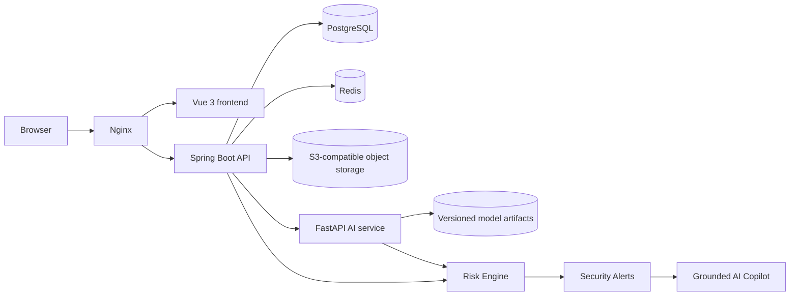

# SecureBiz AI

**Vietnamese thesis:** Xây dựng hệ thống Web quản lý hoạt động kinh doanh và kho hàng doanh nghiệp tích hợp AI phát hiện hành vi người dùng bất thường.

**English thesis:** Development of a Web-Based Business and Inventory Management System with AI-Powered User Behavior Anomaly Detection.

SecureBiz AI is a thesis project and production-oriented business platform for technology-accessory retailers. It combines business and inventory workflows with structured audit data, user-behavior anomaly detection, an explainable risk engine, and a decision-support security copilot.

> Project status: the core business/AI path and RBAC Phase 0 are implemented. The suite applies all 13 Flyway migrations, including the safe ADMIN → IT_ADMIN transition and direct user permissions. See [Implementation status](docs/implementation-status.md).

## Architectural principles

- Spring Boot is the system of record and the only public business API.
- PostgreSQL stores transactional and audit metadata; Redis supports bounded cache, rate limiting, and token/session metadata.
- A maintained S3-compatible service stores objects; PostgreSQL stores object keys and immutable metadata.
- The Python service performs feature engineering, training/evaluation, and inference. It is not a second business backend.
- Detection, assessment, and explanation remain separate: **ML → anomaly detection; Risk Engine → contextual risk; LLM → grounded explanation**.
- Inventory is changed only through transaction-safe domain services that also append stock ledger entries.
- Authorization is permission-based RBAC; UI visibility never replaces server authorization.
- Operational timestamps are stored in UTC and localized only at presentation boundaries.

## Target architecture



## Technology stack

| Area | Technology |
|---|---|
| Frontend | Vue 3, TypeScript, Vite, Pinia, Vue Router, Axios, Tailwind CSS |
| Backend | Java 21, Spring Boot, Spring Security, Spring Data JPA, Flyway, OpenAPI |
| Data | PostgreSQL, Redis, RustFS/S3-compatible storage |
| AI | Python, FastAPI, Pandas, NumPy, scikit-learn, Joblib; optional PyTorch |
| Delivery | Docker Compose, Nginx |

## Planned modules

Identity & RBAC; organization; catalog; multi-warehouse inventory; purchases; POS/orders/payments/invoices; returns/refunds; customers; documents; reporting; audit/security events; ML pipeline; risk engine; security center; grounded security copilot.

## Repository layout

```text
frontend/       Vue application (Phase 1 implementation)
backend/        Spring Boot application and Flyway migrations
ai-service/     FastAPI inference and reproducible ML pipeline
database/       Data-model notes and database utilities
docker/         Container and reverse-proxy configuration
docs/           Architecture and thesis-supporting decisions
scripts/        Repeatable local verification commands
```

## Documentation

- [Architecture](docs/architecture.md)
- [Database design and ERD](docs/database-design.md)
- [API design](docs/api-design.md)
- [Security design](docs/security-design.md)
- [RBAC and IT administration](docs/rbac-it-admin.md)
- [AI/ML design](docs/ai-design.md)
- [Business rules](docs/business-rules.md)
- [Implementation roadmap](docs/roadmap.md)
- [Phase 1 progress](docs/phase-1-progress.md)
- [Implementation status](docs/implementation-status.md)
- [Requirement completion audit](docs/completion-audit.md)
- [AI experiment guide](docs/ai-experiment-guide.md)
- [Setup guide](docs/setup-guide.md)
- [Thesis demo runbook](docs/demo-runbook.md)
- [Hardening review](docs/hardening-report.md)
- [Threat model](docs/threat-model.md)
- [ADR: S3-compatible object storage](docs/adr-001-s3-object-storage.md)

## Prerequisites (for implementation phases)

- Git
- Docker Engine with Docker Compose v2
- Node.js LTS and pnpm/npm
- Java 21+ and the committed Maven Wrapper 3.9.11
- Python 3.12+ (to be pinned when the AI service is scaffolded)

## Configuration

Copy `.env.example` to `.env`, replace every `change-me`/`replace-with` value, and keep `.env` local. Browser-exposed variables must be limited to non-secret `VITE_` values.

## Local workflow

The complete development stack is declared in Compose:

```bash
docker compose config
docker compose up --build
```

Application commands:

```bash
docker compose up --build
cd backend && ./mvnw flyway:migrate test
cd frontend && npm install && npm run dev
cd ai-service && python -m pytest
```

Flyway will be the only supported mechanism for evolving shared schemas. Migrations will be immutable after they have reached a shared environment.

## Delivery policy

Each phase follows **Analyze → Design → Implement → Test → Document → Review**. A feature is complete only when its build and relevant automated tests have run successfully. Experimental metrics must be generated from identified datasets and reproducible runs; no evaluation values or anomaly scores are fabricated.

## Current next step

Run the full Compose stack on a Docker-capable machine and execute the thesis runbook to verify real Redis/object-storage persistence and container networking. Replace synthetic-only research evidence with ethically collected, clearly labeled system observations when available. Do not enable the copilot until its provider and data policy are approved.
