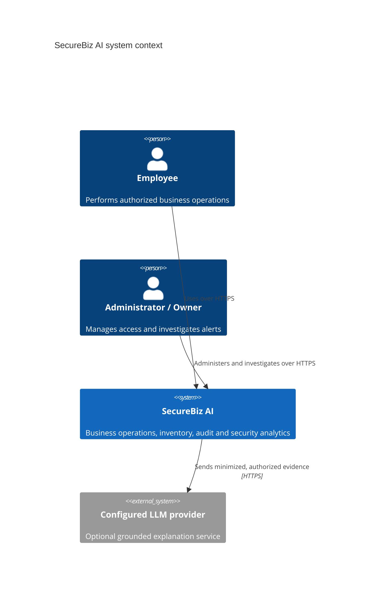
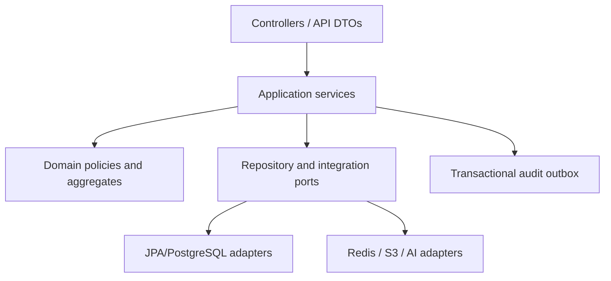

# Architecture

## Context and quality goals

SecureBiz AI supports transaction-heavy retail operations while producing research-quality behavioral telemetry. The primary quality goals are correctness under concurrency, least privilege, traceability, reproducibility, explainability, and incremental delivery.

## System boundaries

The browser calls only the Spring Boot API through Nginx. The backend owns business decisions and invokes the internal AI service using service authentication. Direct browser-to-AI, browser-to-database, and AI-to-business-database writes are prohibited.

## Runtime containers

| Container | Responsibility | Must not own |
|---|---|---|
| Vue frontend | UX, client validation, permission-aware presentation | Authorization or business truth |
| Spring Boot backend | Domain workflows, authorization, transactions, audit emission, risk orchestration | Model training |
| PostgreSQL | Durable operational, ledger, audit and security metadata | Large object bodies |
| Redis | Rate-limit counters, bounded cache, revocation/session hints | Source-of-truth business data |
| RustFS/S3-compatible storage | Versioned product/document objects | Authorization metadata |
| FastAPI AI service | Feature transformation, versioned inference, model metadata | Business workflow mutation |
| Nginx | TLS termination/reverse proxy/static frontend | Application authorization |

## Backend modular monolith

Begin as a modular monolith rather than premature microservices. Suggested packages are `identity`, `organization`, `catalog`, `inventory`, `purchasing`, `sales`, `documents`, `audit`, `security`, `reporting`, and `shared`. Each module exposes application services; controllers never call another module's repository directly.

Cross-module consistency initially uses one PostgreSQL transaction. External calls are not held inside long database transactions; use an outbox/job record for AI analysis, notifications, and object cleanup.

## Key design decisions

1. **Inventory uses balance plus immutable ledger.** `inventory` is the lockable current projection; every accepted change creates `stock_transactions` and items in the same transaction.
2. **Optimistic metadata + pessimistic stock locking.** General entities use a version column where useful. Stock mutation locks inventory rows in a deterministic order to prevent overselling and deadlocks.
3. **Idempotency at command boundaries.** Checkout, receiving, refund, transfer dispatch/receive, and sensitive uploads accept an idempotency key scoped to actor and operation.
4. **Transactional audit/outbox.** The business mutation and structured audit/outbox record commit together. Sensitive field redaction happens before persistence.
5. **Separate security concepts.** Activity logs record facts, security events record interpreted signals, predictions record model outputs, risk scores record assessments, and alerts record investigation lifecycle.
6. **AI artifacts are versioned.** Feature schema, preprocessing pipeline, model artifact, threshold, training dataset manifest, code version, and metrics are tied to a model version.
7. **Grounded LLM only.** The copilot receives an authorization-filtered evidence bundle with citations/IDs and cannot execute business commands.

## Critical workflows

### Checkout

Validate command and permission → resolve idempotency → lock inventory rows in stable order → verify available quantity → create order/payment records → append stock transaction → update inventory projection → issue invoice → append audit/outbox → commit.

Payment provider integration, when introduced, requires a pending payment state and reconciliation/compensation flow rather than pretending a remote payment is atomic with PostgreSQL.

### Purchase receiving

Lock purchase order and target inventory → verify approved/receivable state and remaining quantities → create receipt and stock ledger entry → update received quantities/balance → transition status → audit → commit.

### Security analysis

Structured activity → aggregation window and hierarchical baseline selection → durable feature snapshot → versioned ML inference → transactional prediction/risk/alert persistence → investigator feedback. The remote inference call runs without holding a database transaction open. LLM explanation is downstream and cannot alter the chain.

## Non-functional baselines

- API versioning under `/api/v1`; cursor or page pagination depending on dataset.
- UTC `timestamptz`, ISO-8601 at APIs, locale conversion in UI.
- `NUMERIC(19,4)` or currency-specific scale for money; no floating point.
- Correlation/request IDs across HTTP, audit, AI, and jobs.
- Health endpoints distinguish liveness and readiness; dependencies are readiness checks.
- Metrics cover request latency/error rate, DB pool, stock conflicts, job lag, model latency/drift and alert volume.

## Deployment evolution

Development uses Docker Compose. A single backend remains appropriate through thesis scope. Independently scale the stateless frontend/API/AI inference only after measurement. Production needs managed secrets, TLS, backups with restore testing, object versioning/retention, centralized logs, and restricted networks.
