# Database Design and ERD

## Conventions

- PostgreSQL names use `snake_case`; primary keys use UUID (application-generated UUIDv7 when supported) to avoid enumerable identifiers.
- Time instants use `timestamptz` in UTC; business dates use `date`.
- Money uses `numeric(19,4)` plus a three-character ISO currency code.
- Mutable aggregates may have `version bigint not null` for optimistic locking.
- Core tables contain `created_at` and `updated_at`; actor columns are added where meaningful.
- Enumerated lifecycle values start as checked `varchar` columns to permit controlled migration.
- Audit, ledger, payment, invoice and prediction history is not physically deleted through normal APIs.

## Domain ERD

The diagram shows cardinalities and intentionally omits many scalar fields. Flyway migrations remain the executable schema once implementation begins.

```mermaid
erDiagram
    USERS ||--o{ USER_ROLES : assigned
    ROLES ||--o{ USER_ROLES : contains
    ROLES ||--o{ ROLE_PERMISSIONS : grants
    PERMISSIONS ||--o{ ROLE_PERMISSIONS : included
    USERS ||--o{ AUTH_SESSIONS : opens
    AUTH_SESSIONS ||--o{ REFRESH_TOKENS : rotates
    DEPARTMENTS o|--o{ DEPARTMENTS : parent_of
    DEPARTMENTS ||--o{ EMPLOYEES : includes
    EMPLOYEES o|--o| USERS : account
    EMPLOYEES o|--o{ DEPARTMENTS : manages

    CATEGORIES o|--o{ CATEGORIES : parent_of
    CATEGORIES ||--o{ PRODUCTS : classifies
    BRANDS ||--o{ PRODUCTS : brands
    PRODUCTS ||--|{ PRODUCT_VARIANTS : offers
    PRODUCTS ||--o{ PRODUCT_IMAGES : displays
    WAREHOUSES ||--o{ INVENTORY : holds
    PRODUCT_VARIANTS ||--o{ INVENTORY : stocked_as
    STOCK_TRANSACTIONS ||--|{ STOCK_TRANSACTION_ITEMS : contains
    WAREHOUSES ||--o{ STOCK_TRANSACTIONS : records
    PRODUCT_VARIANTS ||--o{ STOCK_TRANSACTION_ITEMS : moves

    STOCK_TRANSFERS ||--|{ STOCK_TRANSFER_ITEMS : requests
    WAREHOUSES ||--o{ STOCK_TRANSFERS : source
    WAREHOUSES ||--o{ STOCK_TRANSFERS : destination
    PRODUCT_VARIANTS ||--o{ STOCK_TRANSFER_ITEMS : transfers
    STOCKTAKES ||--|{ STOCKTAKE_ITEMS : counts
    WAREHOUSES ||--o{ STOCKTAKES : occurs_at

    SUPPLIERS ||--o{ PURCHASE_ORDERS : receives
    WAREHOUSES ||--o{ PURCHASE_ORDERS : destination
    PURCHASE_ORDERS ||--|{ PURCHASE_ORDER_ITEMS : contains
    PURCHASE_ORDERS ||--o{ GOODS_RECEIPTS : received_by
    GOODS_RECEIPTS ||--|{ GOODS_RECEIPT_ITEMS : contains

    CUSTOMERS o|--o{ ORDERS : places
    WAREHOUSES ||--o{ ORDERS : fulfills
    ORDERS ||--|{ ORDER_ITEMS : contains
    ORDERS ||--o{ PAYMENTS : paid_by
    ORDERS ||--o| INVOICES : invoiced_as
    ORDERS ||--o{ RETURNS : returned_by
    RETURNS ||--|{ RETURN_ITEMS : contains
    RETURNS ||--o{ REFUNDS : refunded_by

    DOCUMENTS ||--|{ DOCUMENT_VERSIONS : versions
    DOCUMENTS ||--o{ DOCUMENT_ACCESS_LOGS : accessed
    DEPARTMENTS o|--o{ DOCUMENTS : owns

    USERS ||--o{ ACTIVITY_LOGS : performs
    AUTH_SESSIONS o|--o{ ACTIVITY_LOGS : groups
    ACTIVITY_LOGS o|--o{ SECURITY_EVENTS : triggers
    MODEL_VERSIONS ||--o{ AI_PREDICTIONS : produces
    USERS ||--o{ AI_PREDICTIONS : evaluated
    AI_PREDICTIONS o|--o{ USER_RISK_SCORES : contributes
    USERS ||--o{ USER_RISK_SCORES : assessed
    SECURITY_EVENTS o|--o{ SECURITY_ALERTS : raises
    USER_RISK_SCORES o|--o{ SECURITY_ALERTS : supports
```

## Table catalog and essential constraints

### Identity and organization

- `users`: unique normalized username/email, password hash, status, failed-login counters, lock expiry, last login; never return hash.
- `roles`, `permissions`: unique code; permission follows `resource.action` convention.
- `user_roles`: unique `(user_id, role_id)` and optional validity interval; assignment actor/time is retained.
- `role_permissions`: unique `(role_id, permission_id)`.
- `auth_sessions`: user, device fingerprint metadata, IP, user agent, started/last-seen/revoked/expiry timestamps.
- `refresh_tokens`: session, token family, **token hash only**, issued/used/revoked/replaced-by fields; unique token hash.
- `departments`: unique code; optional parent and manager. The manager FK is added after employees exist to avoid circular migration ordering.
- `employees`: unique employee code; optional unique user; department, position, employment status and dates.

### Catalog and inventory

- `categories`: unique code and optional parent; prevent cycles in service logic.
- `brands`, `products`, `product_variants`, `product_images`: SKU and non-null barcode are unique; variant prices are non-negative; flexible attributes use validated JSONB.
- `warehouses`: unique code, status and location metadata.
- `inventory`: unique `(warehouse_id, product_variant_id)`, checks `quantity >= 0`, `reserved_quantity >= 0`, and `reserved_quantity <= quantity`; indexed by warehouse and low-stock query fields.
- `stock_transactions`: immutable header with unique reference, type, warehouse, actor, source type/id, reason and occurred time.
- `stock_transaction_items`: variant, signed quantity delta, before/after and cost snapshot; check `quantity_after = quantity_before + quantity_delta`.
- `stock_transfers` and items: source differs from destination; requested, dispatched and received quantities are non-negative and bounded by state-aware service rules.
- `stocktakes` and items: capture system snapshot, actual count, variance, approval and linked adjustment transaction.

### Purchasing and sales

- `purchase_orders` and items: monetary snapshots and status history; ordered/received quantity constraints.
- `goods_receipts` and `goods_receipt_items` (addition to the original list): each physical receipt is explicit and idempotent, enabling partial receipt and preventing double receive.
- `customers`: unique customer code; normalized phone/email indexes where applicable. Derived totals are queried/materialized rather than manually edited.
- `orders`, `order_items`: immutable commercial snapshots after confirmation; item quantity positive and totals non-negative.
- `payments`: append-oriented attempts/transactions with unique external reference; status supports pending, succeeded, failed and reversed.
- `invoices`: unique invoice number and immutable issued snapshot.
- `returns`, `return_items`, `refunds`: link to original order/item/payment, enabling partial history and cumulative upper-bound checks.

### Documents

- `documents`: logical record, owner department, scope, sensitivity, status and current-version reference.
- `document_versions`: immutable version number, object key, original filename, media type, byte size, checksum and uploader; unique `(document_id, version_number)` and object key.
- `document_access_logs`: append-only view/download records with user, version, decision, IP and timestamp.

### Audit and security

- `activity_logs`: append-only structured event with actor/session, action/module, resource, result, request/correlation IDs, network/device metadata, sanitized `old_values`, `new_values`, and contextual JSONB. Partition monthly once volume justifies it.
- `security_events`: signal type/source/severity and structured indicators; may reference an activity log.
- `feature_snapshots`: feature schema version, aggregation window, subject/baseline scope and feature vector. This makes experiments and predictions reproducible.
- `model_versions`: algorithm, artifact URI/checksum, feature schema, preprocessing version, threshold, dataset manifest, code revision, hyperparameters, metrics and lifecycle status.
- `ai_predictions`: model version, feature snapshot, anomaly score, decision, latency and prediction time; raw model output is preserved.
- `risk_policy_versions`: versioned normalized weights, thresholds and activation time.
- `user_risk_scores`: prediction/event inputs, policy version, 0–100 score, level and reason indicators.
- `security_alerts`: source event/risk score, subject, severity, status, assignee/reviewer, resolution and timestamps.
- `alert_status_history`: append-only transitions for defensible investigation history.
- `investigation_notes`: author/time/content with optional evidence references.

### Platform support

- `idempotency_keys`: scoped key, actor, request hash, status and response reference with expiry; unique `(scope, actor_id, key)`.
- `outbox_events`: aggregate, event type, sanitized payload, creation/publish/attempt fields.
- `notifications`, `system_settings`: settings are typed, versioned and audited; secrets belong in a secret manager, never this table.

## Index strategy

Start with indexes serving verified access patterns: normalized login identifiers; all foreign keys used in joins; `(warehouse_id, product_variant_id)`; transaction `(warehouse_id, occurred_at desc)`; order/purchase `(status, created_at desc)`; activity `(user_id, occurred_at desc)`, `(action, occurred_at desc)`, and correlation ID; alert `(status, severity, created_at desc)`; prediction `(user_id, predicted_at desc)`. Avoid indexing every JSONB field; promote stable query dimensions to columns or add targeted expression/GIN indexes after measurement.

## Integrity and concurrency

- Lock inventory rows using `SELECT ... FOR UPDATE` in sorted UUID order during mutation.
- Use unique/idempotency constraints to make retries safe; state transitions include the expected current state.
- Cumulative return/refund/receipt limits require transactional aggregate checks while locking the owning order/payment/purchase row.
- Foreign keys default to `restrict`; use cascade only for true owned drafts/children before finalization.
- Operational deletion uses explicit status/archive where history matters, not universal soft delete.

## Migration plan

Suggested Phase 1 migrations: `V1__extensions_and_shared_types`, `V2__identity_rbac`, `V3__organization`, `V4__sessions_and_tokens`, `V5__audit_foundation`, `V6__seed_permissions`. Seed only deterministic roles/permissions and a development bootstrap path; never embed a production password.
